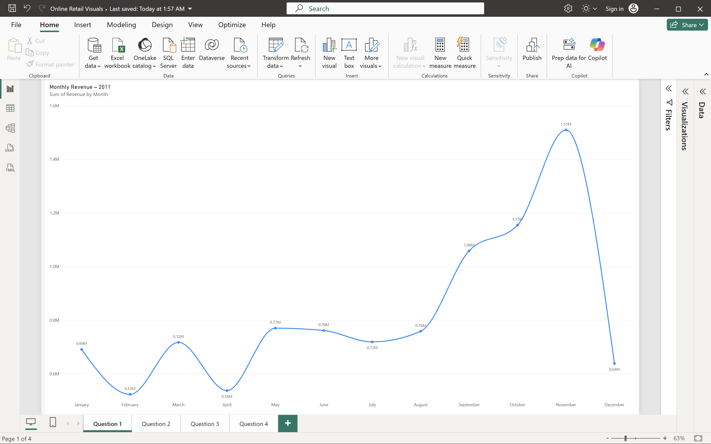
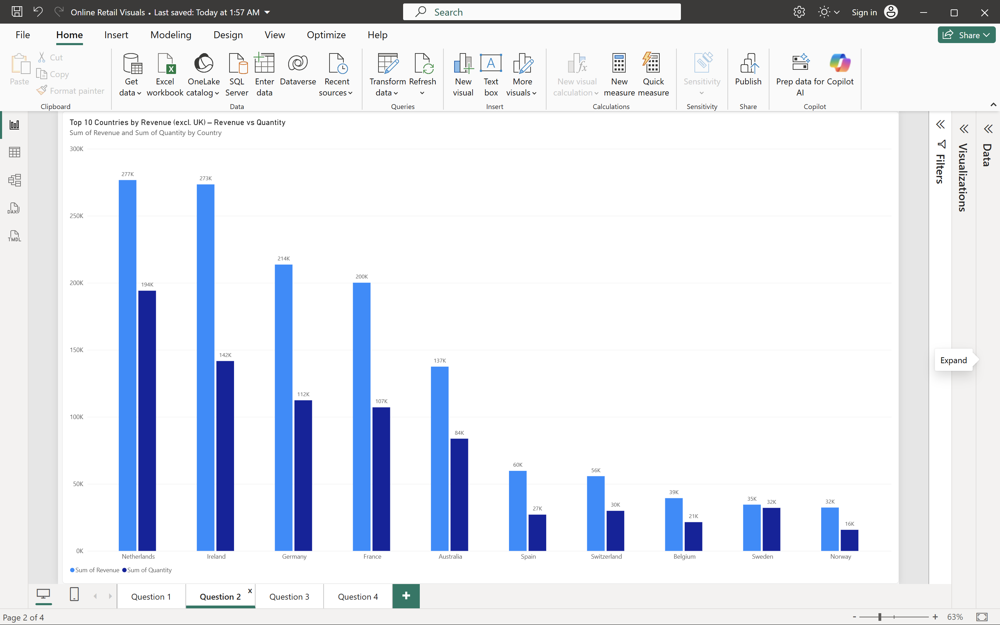
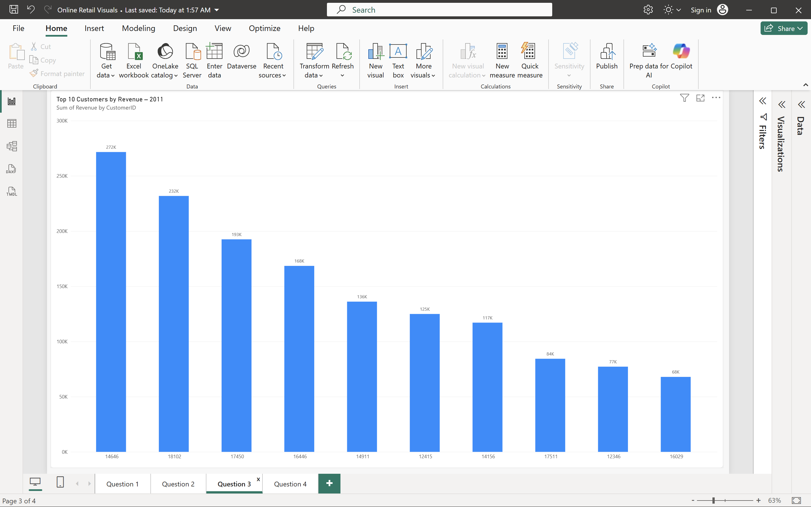
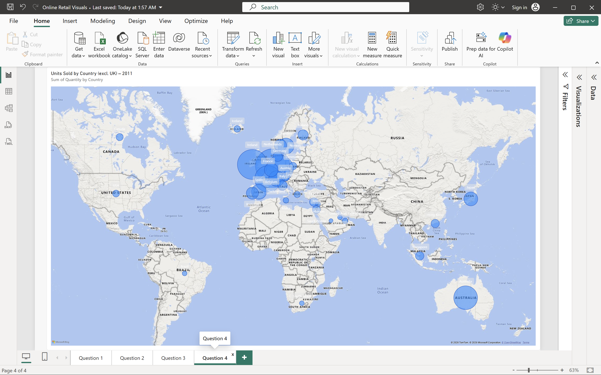

# Online Retail Performance Analysis – Power BI

Data visualisation project completed as part of the **Tata Data Visualisation: Empowering Business with Effective Insights** job simulation on [Forage](https://www.theforage.com/). I acted as a consultant for an online retail store and built visuals to help the CEO and CMO understand revenue drivers and plan international expansion.

> This is a virtual job simulation. I am not employed by Tata.

## Business questions

| # | Stakeholder | Question | Visual |
|---|---|---|---|
| 1 | CEO | How does monthly revenue trend in 2011, and is there seasonality? | Line chart |
| 2 | CMO | Which 10 countries (excluding the UK) generate the most revenue, and how does quantity sold compare? | Clustered column chart |
| 3 | CMO | Who are the top 10 customers by revenue? | Column chart (sorted descending) |
| 4 | CEO | Where is product demand highest outside the UK? | Map |

## Data

- **Source:** Chen, D. (2015). *Online Retail* [Dataset]. UCI Machine Learning Repository. https://doi.org/10.24432/C5BW33 (licensed under CC BY 4.0)
- **Size:** 541,909 transaction lines, December 2010 – December 2011
- **Columns:** InvoiceNo, StockCode, Description, Quantity, InvoiceDate, UnitPrice, CustomerID, Country

## Data preparation (Power Query)

1. Removed rows with **Quantity < 1** (returns and cancellations): 10,624 rows
2. Removed rows with **UnitPrice < 0** (input errors): 2 rows
3. Filtered to **calendar year 2011** so all four analyses cover the same period
4. Standardised country names for mapping: `EIRE` → Ireland, `RSA` → South Africa
5. Set CustomerID to text and Country to the Country/Region data category
6. Created **Revenue = Quantity × UnitPrice**

Result: 489,600 clean transactions and $9.84M in revenue for 2011.

## Key findings

- **Strong seasonality:** revenue peaked in November 2011 at $1.51M. September to November generated about 38% of annual revenue. December looks low only because the data ends on 9 December.
- **Market concentration:** the UK accounts for about 84% of revenue. Outside the UK, the Netherlands ($277K), Ireland ($273K), Germany ($214K) and France ($200K) make up about 62% of non-UK revenue.
- **Different buying behaviour:** the Netherlands and Ireland generate almost the same revenue, but the Netherlands sells far more units (194K vs 142K). Irish customers buy higher-value items.
- **Customer base is diversified:** the top 10 customers account for about 15% of revenue.
- **Data quality insight:** customers 16446 and 12346 appear in the top 10, but each placed one very large order that was later cancelled in full. The required cleaning rule (remove Quantity < 1) removes the cancellation but keeps the original order, so their real net revenue is close to zero.
- **Demand outside the UK** is concentrated in Western Europe, with Australia as the only strong market outside Europe.

## Recommendations

1. Prioritise expansion into the Netherlands, Ireland, Germany and France: proven demand and geographic proximity for shared logistics and marketing.
2. Treat Australia as a test market for growth outside Europe.
3. Prepare inventory, staffing and campaigns before the September–November peak.
4. Add cost and margin data by country before investing, since this dataset only supports revenue-based conclusions.

## Dashboard preview

| Question 1 | Question 2 |
|---|---|
|  |  |
| **Question 3** | **Question 4** |
|  |  |

## Repository contents

```
├── README.md
├── Online Retail Visuals.pbix     # Power BI report (data preparation + 4 visuals)
├── data/
│   └── Online_Retail.xlsx         # Raw dataset (UCI, CC BY 4.0)
└── images/                        # Screenshots of each visual
```

## Tools

Power BI Desktop, Power Query

## Presentation

Video presentation to the CEO and CMO: *[add link here]*
